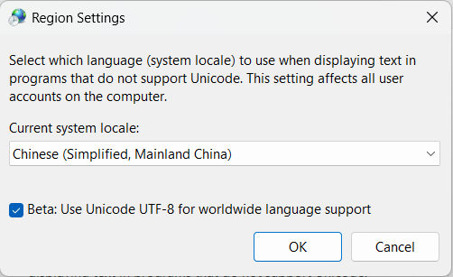

# my-nvim

**English** | [简体中文](README.zh-CN.md)


A personal, **cross-platform** (Windows / Linux) Neovim configuration, built around three ideas:

1. **Speed first** — aggressive lazy-loading, carefully pruned startup work, a keymap layout optimized for minimal keystrokes (leader = `,`).
2. **Swappable engines** — completion, snippets, tabline, colorscheme, markdown renderer and jump motions are all behind tiny selector tables. Trying a different engine is a one-word edit.
3. **Batteries for daily work** — LSP + DAP + CMake, rich markdown authoring (rendering, live browser preview, image paste, Obsidian vault notes), git workflow, and AI/LLM assistance wired into the editor.
It also doubles as the Neovim backend for [VSCode-Neovim](https://github.com/vscode-neovim/vscode-neovim): most plugin specs and keymaps have a `vim.g.vscode` branch, with a dedicated VSCode theme file.

> Developed and daily-driven on **Neovim 0.13-dev (nightly)** on both Windows 11 and Linux; the `main`-branch `nvim-treesitter` and `vim.lsp.enable()` APIs require **Neovim ≥ 0.11**.

## Table of Contents

- [✨ Highlights](#-highlights)
- [📦 Requirements & Installation](#-requirements--installation)
- [🧰 External Dependencies](#-external-dependencies)
- [🗂 Directory Structure](#-directory-structure)
- [🔌 Plugin Catalog](#-plugin-catalog)
- [🔀 Engine Selector Pattern](#-engine-selector-pattern)
- [🗺 Plugin Dependency Graph](#-plugin-dependency-graph)
- [⌨️ Keymaps](#%EF%B8%8F-keymaps)
- [🤖 AI / LLM Setup](#-ai--llm-setup)
- [🪟 Windows & Encoding Notes](#-windows--encoding-notes)
- [🩺 Troubleshooting](#-troubleshooting)
- [🙏 Acknowledgements](#-acknowledgements)

## ✨ Highlights

- **Cross-platform by construction**: every platform difference lives in a `has('win32')` branch — shell (`pwsh` vs `zsh`), build commands, paths, even the markdown-preview installer (deterministic System32 `curl.exe` + `tar.exe` download instead of the flaky PowerShell script).
- **Dual snippet engines coexisting**: `LuaSnip` powers the nvim-cmp popup path, `mini.snippets` powers the manual `C-]` expand / `C-l` jump path — fed from the **same** VSCode-style snippet files and edited in-place with `nvim-scissors` (its save hook hot-reloads both engines).
- **Pluggable jump engines**: hop and leap are currently enabled (`,`-prefixed hints + `s`/`S` labeled jumps); flash and lightspeed specs are kept as ready-to-switch alternates.
- **AI everywhere, provider-agnostic**: `llm.nvim` with a dozen custom app handlers (translate, explain, docstring, commit message, formula recognition…), `codecompanion.nvim` on the GLM Coding Plan endpoint, and `avante.nvim` over the `opencode` ACP — all key-driven from the `,m` / `,n` prefixes.
- **Personal highlight theme**: `lua/theme/zz.lua` defines a `ZZ.*` palette (hop/leap/lightspeed labels, LSP semantic tokens, diff, rainbow delimiters…) that is re-applied on every colorscheme switch, so it survives theme changes on both platforms.
- **Discoverable keymaps**: every custom mapping carries a `zz:`-prefixed `desc`; press `,fk` (snacks picker keymaps) to browse them all.

## 📦 Requirements & Installation

Requirements:

- **Neovim ≥ 0.11** (nightly recommended; daily-tested on 0.13-dev)
- **Git**
- A Nerd Font in your terminal (devicons everywhere)

The repo root holds the config in its `nvim/` subdirectory; clone it directly to your config location:

```bash
# Linux / macOS
git clone https://github.com/<you>/my-nvim.git ~/.config/nvim

# Windows (PowerShell)
git clone https://github.com/<you>/my-nvim.git "$env:LOCALAPPDATA\nvim"
```

First launch:

1. `lazy.nvim` bootstraps itself automatically.
2. Treesitter parsers from the curated list (see [treesitter spec](nvim/lua/plugins/nvim/treesitter.lua)) install on first run — `tree-sitter-cli` must be in `PATH`.
3. Mason installs missing LSP servers (`clangd`, `rust-analyzer`, `lua-language-server`, `pyright`) and DAP adapters (`debugpy`, optionally `codelldb`).
4. `lazy-lock.json` pins every plugin commit; use `:Lazy restore` for a reproducible install.

Uninstall = delete the clone plus `~/.local/share/nvim` (Linux) / `%LOCALAPPDATA%\nvim-data` (Windows).

## 🧰 External Dependencies

| Tool | Used by | Notes |
| --- | --- | --- |
| [Git](https://git-scm.com) | lazy.nvim, git tooling | required |
| [fd](https://github.com/sharkdp/fd) | snacks picker `files` | in `PATH`; Ubuntu/Debian installs it as `fdfind` (auto-detected by the config) |
| [ripgrep](https://github.com/BurntSushi/ripgrep) | snacks picker `grep` | in `PATH` |
| [lazygit](https://github.com/jesseduffield/lazygit/releases) | `,vu` snacks lazygit | binary in `PATH` |
| [tree-sitter-cli](https://github.com/tree-sitter/tree-sitter/releases) | parser compilation | via `cargo install tree-sitter-cli` or the GitHub release; in `PATH` |
| [Node.js](https://nodejs.org) | some tree-sitter parsers (e.g. latex) | in `PATH` |
| [PowerShell 7 (`pwsh`)](https://aka.ms/powershell) | toggleterm shell on Windows | |
| [pylatexenc](https://pypi.org/project/pylatexenc/) | LaTeX rendering in render-markdown | `python -m pip install pylatexenc` (`:checkhealth` python must be OK) |
| [ImageMagick](https://imagemagick.org) | image.nvim (Linux, currently disabled) | `sudo apt install imagemagick` |
| [yazi](https://github.com/sxyazi/yazi) (optional) | `,vy` floating file manager | |
| [opencode](https://opencode.ai) (optional) | codecompanion CLI/chat, avante ACP | CLI in `PATH` |

LSP/DAP binaries are managed by Mason automatically — nothing to install manually.

Treesitter parsers auto-installed by the config:

```
c, cpp, c_sharp, cmake, bash, python, lua, rust, ruby, sql,
markdown, markdown_inline, latex, html, json, json5, yaml,
make, ninja, diff, git_config, ssh_config, vim, vimdoc
```

## 🗂 Directory Structure

```
my-nvim/
├── README.md                    # this file
├── README.zh-CN.md              # 中文版
├── .luarc.json                  # LuaLS: full plugin library ($LOCALAPPDATA + ~/.local/share dual-platform), pathStrict to avoid module-name ambiguity
├── assets/                      # screenshots for docs
└── nvim/                        # ← the actual stdpath('config') content
    ├── init.lua                 # entry: reload + require('config')
    ├── lazy-lock.json           # pinned plugin commits (reproducible installs)
    ├── fdetect/zzft.lua         # *.stl / *.wsd / *.puml → plantuml
    ├── after/plugin/init.lua    # loads theme/zz.lua (single palette, vim.g.vscode-guarded)
    ├── colors/                  # ~1900 vendored classic vim colorschemes (picker `,ov` playground)
    ├── snippets/                # VSCode-style snippet collection (shared by LuaSnip & mini.snippets)
    │   ├── package.json
    │   └── snippets/            # friendly-snippets layout + own global.json
    └── lua/
        ├── config/
        │   ├── init.lua         # module reload chain
        │   ├── base.lua         # options, encoding, clipboard (Zellij osc52), platform branches
        │   ├── lazy.lua         # lazy.nvim bootstrap + setup (leader = ,)
        │   ├── lsp.lua          # native vim.lsp.enable (independent of completion engine)
        │   ├── keymap.lua       # base + VSCode-Neovim keymaps
        │   └── mylua/           # extra keymaps (quickfix/foldcolumn toggles), helpers
        ├── theme/
        │   └── zz.lua           # personal ZZ.* highlight palette (nvim-only groups behind a vim.g.vscode guard)
        └── plugins/
            ├── nvim/            # main spec list (init.lua) + per-plugin specs
            │   ├── cmpn/        # completion engine selector: blinkCmp | nvimCmp
            │   ├── tab/         # tabline selector: bufferline | barbar | tabby
            │   ├── theme/       # colorscheme selector: tokyonight | onedark | catppuccin
            │   └── md/          # markdown suite: renderer selector + preview + images
            ├── mini/            # one file per mini.nvim module
            ├── jump/            # jump engine selector + engines/ (hop/leap/flash/lightspeed)
            └── llm/             # llm.nvim setup + models/prompts/ui/keymaps/extensions
```

## 🔌 Plugin Catalog

The default set is committed below; alternates stay installed-ready behind selectors (see next section). Spec file paths are given relative to `nvim/lua/`.

### Core & Appearance

| Plugin | Purpose | Spec |
| --- | --- | --- |
| [lazy.nvim](https://github.com/folke/lazy.nvim) | plugin manager | `config/lazy.lua` |
| [tokyonight.nvim](https://github.com/folke/tokyonight.nvim) | colorscheme (**active**, `night` style) | `plugins/nvim/theme/tokyonight.lua` |
| [onedark.nvim](https://github.com/navarasu/onedark.nvim) | colorscheme (alternate) | `plugins/nvim/theme/onedark.lua` |
| [catppuccin/nvim](https://github.com/catppuccin/nvim) | colorscheme (alternate) | `plugins/nvim/theme/nvim.lua` |
| [lualine.nvim](https://github.com/nvim-lualine/lualine.nvim) | statusline (global status, tokyonight theme) | `plugins/nvim/lualine.lua` |
| [bufferline.nvim](https://github.com/akinsho/bufferline.nvim) | tabline (**active**, slope style, LSP diagnostics) | `plugins/nvim/tab/bufferline.lua` |
| [barbar.nvim](https://github.com/romgrk/barbar.nvim) | tabline (alternate) | `plugins/nvim/tab/barbar.lua` |
| [tabby.nvim](https://github.com/nanozuki/tabby.nvim) | tabline (alternate) | `plugins/nvim/tab/tabby.lua` |
| [snacks.nvim](https://github.com/folke/snacks.nvim) | dashboard · explorer · picker · notifier · zen/zoom · scratch · statuscolumn · indent · words (`,f`/`,v`/`,g`/`,b` prefixes) | `plugins/snacks/*` |
| [mini.icons](https://github.com/echasnovski/mini.nvim) | icon provider (used by render-markdown, grug-far, snacks picker…) | `plugins/mini/icons.lua` |
| [nvim-web-devicons](https://github.com/nvim-tree/nvim-web-devicons) | filetype icons (lualine, bufferline) | dependency |
| [rainbow-delimiters.nvim](https://github.com/hiphish/rainbow-delimiters.nvim) | rainbow parentheses (treesitter) | `plugins/nvim/rainbow.lua` |
| [nvim-colorizer.lua](https://github.com/catgoose/nvim-colorizer.lua) | color hex/rgb preview (maintained fork) | `plugins/nvim/nvimColorizer.lua` |
| [aegis.nvim](https://github.com/aekasitt/aegis.nvim) | keystroke latency/counter (`:AegisToggle`) | `plugins/nvim/aegis.lua` |

### File & Project Navigation

| Plugin | Purpose | Spec |
| --- | --- | --- |
| [snacks.nvim](https://github.com/folke/snacks.nvim) — explorer | file explorer sidebar (`,vn`; `P` previews in the main window) | `plugins/snacks/picker.lua` |
| [project.nvim](https://github.com/ahmedkhalf/project.nvim) | auto-root-detection (`pattern`: `.git`, `Cargo.toml`, `CMakeLists.txt`…) + global cwd pinning | `plugins/nvim/project.lua` |
| [aerial.nvim](https://github.com/stevearc/aerial.nvim) | symbol outline (lsp + treesitter + markdown backends) | `plugins/nvim/aerial.lua` |
| [toggleterm.nvim](https://github.com/akinsho/toggleterm.nvim) | floating terminals (shell, yazi — 100% width / 85% height; cmake executor/runner) | `plugins/nvim/toggleterm.lua` |

### Fuzzy Finding & Search

| Plugin | Purpose | Spec |
| --- | --- | --- |
| [snacks.nvim](https://github.com/folke/snacks.nvim) — picker | fuzzy finder for everything (`,f` prefix; telescope-style layout with the list on top) | `plugins/snacks/picker.lua` |
| [grug-far.nvim](https://github.com/MagicDuck/grug-far.nvim) | find & replace (`,rd`/`,ra` file/project scope, `,rs`/`,rf` cword variants) | `plugins/nvim/grugFar.lua` |

### Completion & Snippets

| Plugin | Purpose | Spec |
| --- | --- | --- |
| [blink.cmp](https://github.com/Saghen/blink.cmp) | completion engine (**active**; v2 + blink.lib, Rust fuzzy matcher via `build`, builtin lsp/path/buffer/cmdline providers + llm.nvim ghost completions, LuaSnip snippet preset) | `plugins/nvim/cmpn/blinkCmp.lua` |
| [nvim-cmp](https://github.com/hrsh7th/nvim-cmp) | completion engine (alternate; LSP/buffer/path + `/` and `:` cmdline sources) | `plugins/nvim/cmpn/nvimCmp.lua` |
| [cmp-nvim-lsp](https://github.com/hrsh7th/cmp-nvim-lsp) / [cmp-buffer](https://github.com/hrsh7th/cmp-buffer) / [cmp-path](https://github.com/hrsh7th/cmp-path) / [cmp-cmdline](https://github.com/hrsh7th/cmp-cmdline) | nvim-cmp sources (loaded only when nvim-cmp is selected) | dependencies |
| [LuaSnip](https://github.com/L3MON4D3/LuaSnip) | snippet engine, cmp-popup path (`A-l`/`A-h` jump) | `plugins/nvim/luaSnip.lua` |
| [mini.snippets](https://github.com/echasnovski/mini.nvim) | snippet engine, manual path (`C-]` expand, `C-l`/`C-h` jump) | `plugins/mini/snippet.lua` |
| [cmp_luasnip](https://github.com/saadparwaiz1/cmp_luasnip) / [cmp-mini-snippets](https://github.com/abeldekat/cmp-mini-snippets) | bridge each engine into nvim-cmp | dependencies |
| [nvim-scissors](https://github.com/chrisgrieser/nvim-scissors) | add/edit snippets on the fly (`,za` / `,ze`); patched to hot-reload mini.snippets too | `plugins/nvim/nvimScissors.lua` |

### Motions & Text Editing

| Plugin | Purpose | Spec |
| --- | --- | --- |
| [mini.ai](https://github.com/echasnovski/mini.nvim) | enhanced text objects (`iarb()`…) | `plugins/mini/ai.lua` |
| [mini.surround](https://github.com/echasnovski/mini.nvim) | surround ops (`ys`/`ds`/`cs`, custom `/* */` and `#if 0` pairs) | `plugins/mini/surround.lua` |
| [mini.operators](https://github.com/echasnovski/mini.nvim) | evaluate/exchange/replace/sort/multiply operators | `plugins/mini/operators.lua` |
| [mini.align](https://github.com/echasnovski/mini.nvim) | align/split with preview (`gA`) | `plugins/mini/align.lua` |
| [mini.comment](https://github.com/echasnovski/mini.nvim) | commenting | `plugins/mini/comment.lua` |
| [mini.bracketed](https://github.com/echasnovski/mini.nvim) | `[x`/`]x` traversal for everything | `plugins/mini/bracketed.lua` |
| [mini.diff](https://github.com/echasnovski/mini.nvim) | hunk ops (`gl`/`gL` apply/reset, `[g`/`]g` navigate) | `plugins/mini/diff.lua` |
| [hop.nvim](https://github.com/smoka7/hop.nvim) | jump engine (**active**): `,w`/`,b` words, `,j`/`,k` lines, `,J`/`,K` vertical, `,s` char, `,z` pattern | `plugins/jump/engines/hop.lua` |
| [leap.nvim](https://codeberg.org/andyg/leap.nvim) | jump engine (**active**): `s`/`S` labeled jump, `,x`/`,X` one-way traversal, `gk` Visitor remote ops, `o`-mode `z`/`x`/`Z`/`X` | `plugins/jump/engines/leap.lua` |
| [flash.nvim](https://github.com/folke/flash.nvim) | jump engine (alternate; hop+lightspeed superset mapping) | `plugins/jump/engines/flash.lua` |
| [lightspeed.nvim](https://github.com/ggandor/lightspeed.nvim) | jump engine (alternate, archived upstream) | `plugins/jump/engines/lightspeed.lua` |
| [vim-repeat](https://github.com/tpope/vim-repeat) | `.` repeat for plugin maps | dependency of leap |

### Git

| Plugin | Purpose | Spec |
| --- | --- | --- |
| [snacks.nvim](https://github.com/folke/snacks.nvim) — lazygit | lazygit in a floating window (`,vu`); opens from the AI commit flow too | `plugins/snacks/snacks.lua` |
| [diffview.nvim](https://github.com/sindrets/diffview.nvim) | git diff / file history UI (`,do`/`,dc`/`,dr`/`,dh`) | `plugins/nvim/diffview.lua` |

### Markdown Suite

| Plugin | Purpose | Spec |
| --- | --- | --- |
| [render-markdown.nvim](https://github.com/MeanderingProgrammer/render-markdown.nvim) | in-editor markdown rendering (**active** renderer; LaTeX via `latex2text`, extensive tuning; `,e,`/`,e.` toggle/preview) | `plugins/nvim/md/renderMarkdown.lua` |
| [markview.nvim](https://github.com/OXY2DEV/markview.nvim) | markdown renderer (alternate, hybrid-mode) | `plugins/nvim/md/markview.lua` |
| [markdown-preview.nvim](https://github.com/iamcco/markdown-preview.nvim) | live browser preview (`,e/`); **custom deterministic build** — Windows downloads the prebuilt binary with System32 `curl.exe`/`tar.exe` (the stock PowerShell installer is bypassed) | `plugins/nvim/md/markdownPreview.lua` |
| [img-clip.nvim](https://github.com/HakonHarnes/img-clip.nvim) | paste images from clipboard into markdown (loads on all platforms; the `,ep` keymap is Windows-only) | `plugins/nvim/md/imgClip.lua` |
| [image.nvim](https://github.com/3rd/image.nvim) | in-terminal image rendering (Linux-only, currently disabled) | `plugins/nvim/md/image.lua` |
| [obsidian.nvim](https://github.com/obsidian-nvim/obsidian.nvim) | vault notes (`,o` prefix) over `D:/vaults/{personal,work}` (`~/vaults` on Linux): `:Obsidian` subcommand palette, daily notes under `<vault>/daily/` per workspace, wiki-link/tag completion through the in-process LSP (`[[`/`#`/`^`), backlinks/links/toc/rename; visual rendering is left to render-markdown (`ui.enable=false`); lazy-loads on `ft=markdown` | `plugins/note/obsidian.lua` |

### LSP · DAP · Build

| Plugin | Purpose | Spec |
| --- | --- | --- |
| [nvim-lspconfig](https://github.com/neovim/nvim-lspconfig) | LSP server configs (native `vim.lsp.enable`: clangd, rust-analyzer, lua_ls, pyright) | `config/lsp.lua` |
| [mason.nvim](https://github.com/mason-org/mason.nvim) / [mason-lspconfig](https://github.com/mason-org/mason-lspconfig.nvim) | tool installer; auto-installs the LSP list above | `plugins/nvim/lspDap.lua` |
| [nvim-dap](https://github.com/mfussenegger/nvim-dap) / [nvim-dap-ui](https://github.com/rcarriga/nvim-dap-ui) / [mason-nvim-dap](https://github.com/jay-babu/mason-nvim-dap.nvim) / [nvim-nio](https://github.com/nvim-neotest/nvim-nio) | debugging; custom debugpy adapter on Windows; `F1–F12` keymaps | `plugins/nvim/lspDap.lua` |
| [cmake-tools.nvim](https://github.com/Civitasv/cmake-tools.nvim) | CMake build/run/debug from the editor (`,c` prefix; executor/runner via toggleterm) | `plugins/nvim/cmake.lua` |
| [nvim-treesitter](https://github.com/nvim-treesitter/nvim-treesitter) (`main` branch) | parsing/highlighting/folding; `llm`↔markdown & `zsh`↔bash filetype registration | `plugins/nvim/treesitter.lua` |

### AI / LLM

| Plugin | Purpose | Spec |
| --- | --- | --- |
| [llm.nvim](https://github.com/Kurama622/llm.nvim) | chat + custom app handlers (`,m` prefix): translate, explain, docstring, test generation, code optimization, commit messages, formula recognition, account info…; multi-provider model table | `plugins/llm/` |
| [codecompanion.nvim](https://github.com/olimorris/codecompanion.nvim) | AI assistant (`,n` prefix) on the GLM Coding Plan endpoint + `opencode` CLI agent | `plugins/nvim/codecompanion.lua` |
| [avante.nvim](https://github.com/yetone/avante.nvim) | Cursor-like AI sidebar over the `opencode` ACP | `plugins/nvim/avante.lua` |

Dependencies of the AI stack: [plenary.nvim](https://github.com/nvim-lua/plenary.nvim), [nui.nvim](https://github.com/MunifTanjim/nui.nvim), [mega.cmdparse](https://github.com/ColinKennedy/mega.cmdparse) (+ mega.logging).

## 🔀 Engine Selector Pattern

Several "slots" in this config are one-word switches. Each slot directory has an `init.lua` that maps a local variable to exactly one spec file:

```lua
-- plugins/nvim/cmpn/init.lua
local cmp = 'blinkcmp'         -- 'blinkcmp' | anything else → nvimcmp
-- plugins/nvim/tab/init.lua
local tab  = 'buf'             -- 'buf' → bufferline | 'barbar' | 'tabby'
-- plugins/nvim/theme/init.lua
local theme = 'tokyonight'     -- 'tokyonight' | 'onedark' | 'nvim' (catppuccin)
-- plugins/nvim/md/init.lua
local md = 'render'            -- 'render' → render-markdown | 'markview'
-- plugins/jump/init.lua
local engines = { 'hop', 'leap' }   -- list: hop / leap / flash / lightspeed
-- plugins/nvim/cmpn/nvimCmp.lua (snippet source inside nvim-cmp)
local snipEngine = 'luasnip'   -- 'luasnip' | 'mini'
```

Change a word, restart Neovim — done. The alternate specs are deliberately **not dead code**: they keep working keymaps and highlights (the `ZZ.*` theme covers hop, leap, flash-class labels, lightspeed, cmp…), so switching engines never leaves you with broken UI.

```mermaid
flowchart LR
    subgraph slots["Selector slots (one word each)"]
        direction LR
        CMP["cmpn/init.lua<br/><b>cmp = 'blinkcmp'</b>"]
        TAB["tab/init.lua<br/><b>tab = 'buf'</b>"]
        THEME["theme/init.lua<br/><b>theme = 'tokyonight'</b>"]
        MD["md/init.lua<br/><b>md = 'render'</b>"]
        JUMP["jump/init.lua<br/><b>engines = {'hop','leap'}</b>"]
        SNIP["cmpn/nvimCmp.lua<br/><b>snipEngine = 'luasnip'</b>"]
    end

    CMP -->|"blinkcmp"| C2[blink.cmp]
    CMP -->|"else"| C1[nvim-cmp]
    THEME --> TH1[tokyonight]
    THEME --> TH2[onedark]
    THEME --> TH3[catppuccin]
    TAB -->|"buf"| B1[bufferline]
    TAB -->|"barbar"| B2[barbar]
    TAB -->|"else"| B3[tabby]
    THEME --> TH1[tokyonight]
    THEME --> TH2[onedark]
    THEME --> TH3[catppuccin]
    MD --> M1[render-markdown]
    MD --> M2[markview]
    JUMP --> J1[hop]
    JUMP --> J2[leap]
    JUMP -.->|alternate| J3[flash]
    JUMP -.->|alternate| J4[lightspeed]
    SNIP --> S1[LuaSnip]
    SNIP --> S2[mini.snippets]

    style slots fill:#1f2335,stroke:#7aa2f7
```



## 🗺 Plugin Dependency Graph

Startup chain and the notable inter-plugin relationships:

```mermaid
flowchart TD
    INIT["init.lua"] --> CFG["config/init.lua"]
    CFG --> BASE["base.lua<br/>options · encoding · clipboard"]
    CFG --> LAZY["lazy.lua<br/>bootstrap + { import = 'plugins' }"]
    CFG --> LSP["lsp.lua<br/>vim.lsp.enable"]
    CFG --> KM["keymap.lua<br/>nvim + vscode branches"]
    AFT["after/plugin/init.lua"] --> ZZ["theme/zz.lua<br/>(vim.g.vscode guard)"]

    LAZY --> P1["plugins/nvim/init.lua"]
    LAZY --> P2["plugins/mini/init.lua"]
    LAZY --> P3["plugins/jump/init.lua"]
    LAZY --> P4["plugins/llm/init.lua"]

    %% completion & snippets
    CMPC[nvim-cmp] --> CNL[cmp-nvim-lsp] --> LSPC[nvim-lspconfig]
    CMPC --> CBUF[cmp-buffer] & CPATH[cmp-path] & CCMD[cmp-cmdline]
    CMPC --> CLS[cmp_luasnip] --> LS[LuaSnip]
    CMPC --> CMS[cmp-mini-snippets] --> MINIS[mini.snippets]
    SCISS[nvim-scissors] --> SNACKS[snacks.nvim]
    SCISS -.patches reload.-> LS

    %% fuzzy finding / navigation
    SNACKS --> PLEN[plenary.nvim]
    AER[aerial.nvim] --> TS[nvim-treesitter]
    AER -.->|backend| LSPC

    %% tree / ui
    LUAL[lualine] --> DEV[nvim-web-devicons] & MINI[mini.nvim]
    BUFL[bufferline] --> DEV
    RM[render-markdown] --> TS
    RM -.icons.-> MINI
    RBD[rainbow-delimiters] --> TS
    GRGF[grug-far] -.icons.-> MINI

    %% git
    DIFFV[diffview.nvim]
    MINID[mini.diff]

    %% lsp/dap/build
    MASONL[mason-lspconfig] --> MASON[mason.nvim] & LSPC
    DAPUI[nvim-dap-ui] --> NIO[nvim-nio] & DAP[nvim-dap]
    DAP --> MNDAP[mason-nvim-dap] --> MASON
    CMAKE[cmake-tools] --> PLEN
    CMAKE -- "executor/runner" --> TOGG[toggleterm]
    CMAKE -- F4 debug --> DAP

    %% ai
    LLM[llm.nvim] --> PLEN & NUI[nui.nvim]
    CC[codecompanion] --> PLEN & TS
    AV[avante] --> PLEN & NUI & MEGA[mega.cmdparse<br/>+ mega.logging]
    BLINK[blink.cmp] -.completion source.-> LLM

    %% jump engines highlights
    ZZ -.->|"ZZ.* groups"| HOP[hop] & LEAP[leap]
```



## ⌨️ Keymaps

Leader is `,` (and `maplocalleader` too). Every custom map carries a `zz:`-prefixed description — browse them live with **`,fk`**, or read **[KEYMAPS.md](KEYMAPS.md)**: the auto-generated full table, treesitter-parsed from the sources in this repo and collision-checked (vscode-branch and engine-selector overlaps are flagged there). That file is the single source of truth; this section only keeps the topology.

### Prefix layout

| Prefix | Domain |
| --- | --- |
| `,f` | snacks picker — files / grep / buffers / LSP symbols / jumps / marks / histories / notifications |
| `,g` | git (snacks picker) |
| `,v` | UI & floats — explorer, terminal, yazi, lazygit, scratch, DAP UI, zen/zoom, notifier |
| `,o` | obsidian — global commands; a second buffer-local set lives only inside vault notes |
| `,b` | snacks option toggles — spell, wrap, diagnostics, conceal, treesitter, indent, colorschemes |
| `,e` | buffers & markdown — bufferline, render-markdown, markdown-preview, image paste |
| `,d` / `,m` / `,n` / `,c` / `,z` / `,r` | diffview / llm.nvim / codecompanion / cmake / snippets / grug-far |
| `,w` `,l` `,L` `,s` `,S` | hop — words / after / before / 2-char / pattern |
| `s` `,S` `,x` `,X` `gk` | leap — jump / all windows / one-way traversal / remote ops |
| `F1`–`F12` | DAP session control (`F1`–`F3` DAP UI open/close/toggle) |

### Behavioral notes (not visible in the table)

- **Picker windows**: `<PageUp>`/`<PageDown>` scroll the preview while focus is on the input or list window (the preview pane is a real buffer and scrolls natively); `F12` / `<a-w>` cycles input → list → preview; `F13`–`F21` mirror the in-picker `<a-x>` toggles and `<a-d>` inspect — those `F`-slots exist for an external translation layer (AutoHotkey remaps real chords onto the physically unreachable F13+ range), and the `<a-x>` originals keep working.
- **obsidian scope split**: the note-context commands (backlinks, links, rename, toc, template, follow-link, footnotes, paste image, `]e`/`[e` link nav) are buffer-local and only exist inside vault notes, so they never shadow editor-wide bindings.
- **Markdown engines share slots**: render-markdown owns `e,`/`e.`, markdown-preview owns `e/`; when the markview engine is selected it takes over `e/` and `e.` — the lhs belongs to the slot, not the engine.

## 🤖 AI / LLM Setup

All AI features are optional and key-driven; each reads its API key from an environment variable. Fill in what you have:

| Env var | Provider / usage |
| --- | --- |
| `ZHIPUAI_API_KEY` | Zhipu **GLM Coding Plan** — llm.nvim default model (`glm-5.3`), codecompanion adapter, avante `glm` provider |
| `KIMI_KEY` | Moonshot Kimi (`moonshot-v1-128k`) |
| `DEEPSEEK_TOKEN` | DeepSeek (`deepseek-chat`) |
| `OPENROUTER_KEY` | OpenRouter |
| `GITHUB_TOKEN` | GitHub Models |
| `SILICONFLOW_TOKEN` | SiliconFlow (also used by the `,mu` balance check) |
| `TAVILY_TOKEN` | llm.nvim `web_search` tool |
| `LOCAL_LLM_KEY` | local Ollama |

Model definitions live in [`nvim/lua/plugins/llm/models.lua`](nvim/lua/plugins/llm/models.lua); custom prompts in `prompts.lua`; app handlers (one file each) in `extensions/`. The `,mg` commit-message flow is end-to-end: it reads `git diff --staged`, generates a Conventional Commit message in a floating window, commits via `git commit -F <tempfile>` (no shell-quoting issues), then opens lazygit.

## 🪟 Windows & Encoding Notes

- **Time locale**: `language time English_United States.1252` is set on Windows so time-based snippet insertions don't render in Chinese (see [Troubleshooting](#-troubleshooting), E1).
- **File encodings**: `fileencodings = ucs-bom,utf-8,gbk,latin1` — gb2312/gbk files open correctly; cp936 is listed via its gbk alias.
- **Clipboard in Zellij** (Linux): when `$ZELLIJ` is set, an explicit `osc52` clipboard provider bypasses broken auto-detection inside the multiplexer.
- **Python provider** (Linux): expected at `~/.local/share/nvim/py3venv` (see `config/base.lua`).
- **markdown-preview build**: uses Windows' own System32 `curl.exe` + `tar.exe` with retries — immune to the pwsh5/pwsh7 environment issues of the stock installer; on Linux it runs the plugin's `install.sh`.
- **Shell**: toggleterm uses `pwsh` on Windows, `zsh` elsewhere; the AI BashRunner extension likewise writes `pwsh` vs `bash` scripts per platform.

## 🩺 Troubleshooting

**T1 · LaTeX rendering in markdown (render-markdown.nvim)**

1. Install the latex treesitter parser: `:TSInstall latex` (needs `tree-sitter-cli` + Node.js).
2. Install the converter: `python -m pip install pylatexenc`.
3. `:checkhealth` python must be green.

**T2 · markdown-preview.nvim binary**

This config builds it automatically with a custom `build` function (prebuilt release download on Windows). If you ever need the manual fallback: open a `.md` file and run `:call mkdp#util#install()` (the lazy-loaded context can make the automatic step fail once).

**T3 · image.nvim (currently disabled)**

1. Linux only. 2. Best inside kitty (better than wezterm). 3. Requires ImageMagick: `sudo apt install imagemagick`.

**T4 · Mason install fails or hangs**

- `Could not find executable "npm"` — Neovim started with a trimmed `PATH` (e.g. via a desktop launcher). Launch it from a shell so `/usr/bin` (node/npm) is visible, or fix the launcher's `PATH`.
- Downloads crawl / `Installation was aborted` — slow or blocked access to GitHub releases; export `HTTPS_PROXY` / `HTTP_PROXY` (both cases) before starting Neovim. Install one package at a time.
- `Lockfile exists, installation is already running in another process (pid: xxx)` — another Neovim instance is installing the same package. Close the extra instance first; if that pid is gone, clear leftovers with `rm -rf ~/.local/share/nvim/mason/staging/*`. Use `:MasonInstall --force` only to bypass a stale lock.

**E1 · Inserted time shows in Chinese although the OS time format is US**

Method 1 — set the time locale in the config (already in `config/base.lua`):

```lua
if vim.fn.has('win32') ~= 0 then
    vim.cmd [[ language time English_United States.1252 ]]
end
```

Method 2 — change the system region setting (also fixes E2):



**E2 · latex2text outputs CP936, garbled in Neovim's UTF-8**

Use Method 2 of E1 (system region setting) — it makes `latex2text` emit UTF-8.

**N1 · Nightly (0.13-dev): forward-search labels invisible with flash**

On nvim 0.13-dev, the incsearch redraw of `/` doesn't render `virt_text`, so flash's search labels are invisible for forward search (`?` backward is fine). `set noic` works around it; stable releases are unaffected. Details in the [flash engine spec](nvim/lua/plugins/jump/engines/flash.lua).

## 🙏 Acknowledgements

Built on the shoulders of the Neovim ecosystem — in particular:

- [folke](https://github.com/folke) — lazy.nvim, tokyonight, snacks.nvim, flash
- [echasnovski](https://github.com/echasnovski) — the mini.nvim library
- [nvim-treesitter](https://github.com/nvim-treesitter) and the LSP community
- [Kurama622/llm.nvim](https://github.com/Kurama622/llm.nvim) and [olimorris/codecompanion.nvim](https://github.com/olimorris/codecompanion.nvim) for the AI integration surface

---

License: [MIT](LICENSE).
