# my-nvim

[English](README.md) | **简体中文**


一份个人的**跨平台**（Windows / Linux）Neovim 配置，围绕三个理念搭建：

1. **速度优先** —— 激进的懒加载、精简的启动开销、为最少击键设计的键位布局（leader = `,`）。
2. **引擎可切换** —— 补全、代码片段、文件树、标签栏、配色、Markdown 渲染器、跳转引擎，全部藏在一行选择器变量后面。想换引擎？改一个单词就行。
3. **日用全家桶** —— LSP + DAP + CMake，成体系的 Markdown 写作环境（渲染、浏览器实时预览、贴图），git 工作流，以及接入编辑器的 AI/LLM 助手。

它同时还是 [VSCode-Neovim](https://github.com/vscode-neovim/vscode-neovim) 的 Neovim 后端：绝大部分插件 spec 和键位都有 `vim.g.vscode` 分支，并配有独立的 VSCode 主题文件。

> 在 Windows 11 与 Linux 上以 **Neovim 0.13-dev（nightly）** 日常开发和驱动；`main` 分支的 `nvim-treesitter` 与 `vim.lsp.enable()` API 要求 **Neovim ≥ 0.11**。

## 目录

- [✨ 特性](#-特性)
- [📦 环境要求与安装](#-环境要求与安装)
- [🧰 外部依赖](#-外部依赖)
- [🗂 目录结构](#-目录结构)
- [🔌 插件清单](#-插件清单)
- [🔀 引擎选择器模式](#-引擎选择器模式)
- [🗺 插件依赖关系图](#-插件依赖关系图)
- [⌨️ 键位](#%EF%B8%8F-键位)
- [🤖 AI / LLM 配置](#-ai--llm-配置)
- [🪟 Windows 与编码说明](#-windows-与编码说明)
- [🩺 故障排查](#-故障排查)
- [🙏 致谢](#-致谢)

## ✨ 特性

- **结构性跨平台**：所有平台差异都收敛在 `has('win32')` 分支里 —— shell（`pwsh` vs `zsh`）、build 命令、路径，甚至 markdown-preview 的安装器（用系统自带的 System32 `curl.exe` + `tar.exe` 做确定性下载，绕开坑很多的 PowerShell 安装脚本）。
- **双代码片段引擎并存**：`LuaSnip` 走 nvim-cmp 弹窗路径，`mini.snippets` 走手动 `C-j` / `C-l` 展开路径 —— 两者读**同一套** VSCode 风格片段文件，用 `nvim-scissors` 就地增删改（保存钩子会同时热重载两个引擎）。
- **可插拔跳转引擎**：当前启用 hop + leap（`,` 前缀提示 + `s`/`S` 标签跳转）；flash 和 lightspeed 的 spec 作为随时可切的备胎保留。
- **AI 无处不在、供应商无关**：`llm.nvim` 带十几个自定义 app handler（翻译、解释、文档字符串、提交信息、公式识别……），`codecompanion.nvim` 走 GLM Coding Plan 专用端点，`avante.nvim` 走 `opencode` ACP —— 全部由 `,m` / `,n` 前缀驱动。
- **个人高亮主题**：`lua/theme/zz.lua` 定义了一套 `ZZ.*` 调色板（hop/leap/lightspeed 标签、LSP 语义 token、diff、彩虹括号……），并挂在 `ColorScheme` 自动命令上重新应用，主题怎么换都不丢，双端一致。
- **键位可发现**：所有自定义映射都带 `zz:` 前缀的 `desc`；按 `,fk`（snacks picker 键位表）即可全部浏览。

## 📦 环境要求与安装

环境要求：

- **Neovim ≥ 0.11**（推荐 nightly；日常在 0.13-dev 上测试）
- **Git**
- 终端装有 Nerd Font（到处都是 devicons）

仓库根目录下的 `nvim/` 子目录才是配置本体，直接克隆到配置位置即可：

```bash
# Linux / macOS
git clone https://github.com/<you>/my-nvim.git ~/.config/nvim

# Windows (PowerShell)
git clone https://github.com/<you>/my-nvim.git "$env:LOCALAPPDATA\nvim"
```

首次启动：

1. `lazy.nvim` 自动引导安装自身。
2. 配置里 curated 列表的 treesitter 解析器首次运行时安装（见 [treesitter spec](nvim/lua/plugins/nvim/treesitter.lua)）—— 需要保证 `tree-sitter-cli` 在 `PATH` 里。
3. Mason 自动安装缺失的 LSP server（`clangd`、`rust-analyzer`、`lua-language-server`、`pyright`）与 DAP 适配器（`debugpy`，可选 `codelldb`）。
4. `lazy-lock.json` 锁定所有插件 commit；用 `:Lazy restore` 可复现安装。

卸载 = 删除克隆目录，以及 `~/.local/share/nvim`（Linux）/ `%LOCALAPPDATA%\nvim-data`（Windows）。

## 🧰 外部依赖

| 工具 | 被谁使用 | 说明 |
| --- | --- | --- |
| [Git](https://git-scm.com) | lazy.nvim、git 工具链 | 必需 |
| [fd](https://github.com/sharkdp/fd) | snacks picker `files` | 需在 `PATH`；Ubuntu/Debian 二进制名为 `fdfind`（配置自动检测） |
| [ripgrep](https://github.com/BurntSushi/ripgrep) | snacks picker `grep` | 需在 `PATH` |
| [lazygit](https://github.com/jesseduffield/lazygit/releases) | `,vu` snacks lazygit | 二进制放入 `PATH` |
| [tree-sitter-cli](https://github.com/tree-sitter/tree-sitter/releases) | 解析器编译 | `cargo install tree-sitter-cli` 或下载 GitHub release；需在 `PATH` |
| [Node.js](https://nodejs.org) | 部分 tree-sitter 解析器（如 latex） | 需在 `PATH` |
| [PowerShell 7 (`pwsh`)](https://aka.ms/powershell) | Windows 上 toggleterm 的 shell | |
| [pylatexenc](https://pypi.org/project/pylatexenc/) | render-markdown 的 LaTeX 渲染 | `python -m pip install pylatexenc`（`:checkhealth` 的 python 项须正常） |
| [ImageMagick](https://imagemagick.org) | image.nvim（Linux，当前停用） | `sudo apt install imagemagick` |
| [yazi](https://github.com/sxyazi/yazi)（可选） | `,vy` 浮窗文件管理器 | |
| [opencode](https://opencode.ai)（可选） | codecompanion CLI/chat、avante ACP | CLI 在 `PATH` |

LSP/DAP 的二进制由 Mason 自动管理，无需手动安装。

配置自动安装的 treesitter 解析器：

```
c, cpp, c_sharp, cmake, bash, python, lua, rust, ruby, sql,
markdown, markdown_inline, latex, html, json, json5, yaml,
make, ninja, diff, git_config, ssh_config, vim, vimdoc
```

## 🗂 目录结构

```
my-nvim/
├── README.md                    # 英文版说明
├── README.zh-CN.md              # 本文件
├── .luarc.json                  # LuaLS：全量插件 library（$LOCALAPPDATA + ~/.local/share 双平台）、pathStrict 防模块撞名
├── assets/                      # 文档用截图
└── nvim/                        # ← 实际的 stdpath('config') 内容
    ├── init.lua                 # 入口：reload + require('config')
    ├── lazy-lock.json           # 插件 commit 锁定（可复现安装）
    ├── coc-settings.json        # 备选引擎 coc.nvim 使用
    ├── fdetect/zzft.lua         # *.stl / *.wsd / *.puml → plantuml
    ├── after/plugin/init.lua    # 加载 theme/zz.lua（单一调色板，vim.g.vscode 守卫分流）
    ├── colors/                  # 约 1900 个第三方经典 vim 配色（picker `,ov` 试衣间）
    ├── snippets/                # VSCode 风格片段库（LuaSnip 与 mini.snippets 共用）
    │   ├── package.json
    │   └── snippets/            # friendly-snippets 布局 + 自有 global.json
    └── lua/
        ├── config/
        │   ├── init.lua         # 模块 reload 链
        │   ├── base.lua         # 选项、编码、剪贴板（Zellij osc52）、平台分支
        │   ├── lazy.lua         # lazy.nvim 引导 + setup（leader = ,）
        │   ├── lsp.lua          # 原生 vim.lsp.enable（独立于补全引擎）
        │   ├── keymap.lua       # 基础 + VSCode-Neovim 键位
        │   └── mylua/           # 扩展键位（quickfix/foldcolumn 开关）、小工具
        ├── theme/
        │   └── zz.lua           # 个人 ZZ.* 高亮调色板（nvim 独享组由 vim.g.vscode 守卫分流）
        └── plugins/
            ├── nvim/            # 主 spec 清单（init.lua）+ 各插件 spec
            │   ├── cmpn/        # 补全引擎选择器：nvimCmp | blinkCmp | coc
            │   ├── tab/         # 标签栏选择器：bufferline | barbar | tabby
            │   ├── theme/       # 配色选择器：tokyonight | onedark | catppuccin
            │   └── md/          # Markdown 全家桶：渲染器选择 + 预览 + 图片
            ├── mini/            # mini.nvim 每模块一个文件
            ├── jump/            # 跳转引擎选择器 + engines/（hop/leap/flash/lightspeed）
            └── llm/             # llm.nvim 配置 + models/prompts/ui/keymaps/extensions
```

## 🔌 插件清单

默认启用的组合如下；备选引擎通过选择器随切随用（见下一节）。spec 路径均相对 `nvim/lua/`。

### 外观与基础

| 插件 | 用途 | Spec |
| --- | --- | --- |
| [lazy.nvim](https://github.com/folke/lazy.nvim) | 插件管理器 | `config/lazy.lua` |
| [tokyonight.nvim](https://github.com/folke/tokyonight.nvim) | 配色（**当前启用**，`night` 风格） | `plugins/nvim/theme/tokyonight.lua` |
| [onedark.nvim](https://github.com/navarasu/onedark.nvim) | 配色（备选） | `plugins/nvim/theme/onedark.lua` |
| [catppuccin/nvim](https://github.com/catppuccin/nvim) | 配色（备选） | `plugins/nvim/theme/nvim.lua` |
| [lualine.nvim](https://github.com/nvim-lualine/lualine.nvim) | 状态栏（全局状态栏，tokyonight 主题） | `plugins/nvim/lualine.lua` |
| [bufferline.nvim](https://github.com/akinsho/bufferline.nvim) | 标签栏（**当前启用**，slope 风格，LSP 诊断） | `plugins/nvim/tab/bufferline.lua` |
| [barbar.nvim](https://github.com/romgrk/barbar.nvim) | 标签栏（备选） | `plugins/nvim/tab/barbar.lua` |
| [tabby.nvim](https://github.com/nanozuki/tabby.nvim) | 标签栏（备选） | `plugins/nvim/tab/tabby.lua` |
| [snacks.nvim](https://github.com/folke/snacks.nvim) | dashboard · explorer · picker · notifier · zen/zoom · scratch · statuscolumn · 缩进线 · words（`,v`/`,f`/`,o` 前缀） | `plugins/snacks/*` |
| [mini.icons](https://github.com/echasnovski/mini.nvim) | 图标提供者（render-markdown、grug-far、snacks picker 等在用） | `plugins/mini/icons.lua` |
| [nvim-web-devicons](https://github.com/nvim-tree/nvim-web-devicons) | 文件类型图标（lualine、bufferline） | 依赖 |
| [rainbow-delimiters.nvim](https://github.com/hiphish/rainbow-delimiters.nvim) | 彩虹括号（treesitter） | `plugins/nvim/rainbow.lua` |
| [nvim-colorizer.lua](https://github.com/catgoose/nvim-colorizer.lua) | 颜色值预览（活跃维护 fork） | `plugins/nvim/nvimColorizer.lua` |
| [aegis.nvim](https://github.com/aekasitt/aegis.nvim) | 击键延迟/计数测量（`:AegisToggle`） | `plugins/nvim/aegis.lua` |

### 文件与项目导航

| 插件 | 用途 | Spec |
| --- | --- | --- |
| [snacks.nvim](https://github.com/folke/snacks.nvim) — explorer | 文件树侧栏（`,vn`；按 `P` 在主窗口预览） | `plugins/snacks/picker.lua` |
| [project.nvim](https://github.com/ahmedkhalf/project.nvim) | 项目根自动识别（`pattern`：`.git`、`Cargo.toml`、`CMakeLists.txt`…）+ 全局 cwd 钉死 | `plugins/nvim/project.lua` |
| [aerial.nvim](https://github.com/stevearc/aerial.nvim) | 符号大纲（lsp + treesitter + markdown 后端） | `plugins/nvim/aerial.lua` |
| [toggleterm.nvim](https://github.com/akinsho/toggleterm.nvim) | 浮动终端（shell、yazi —— 100% 宽 / 85% 高；cmake 执行器/运行器） | `plugins/nvim/toggleterm.lua` |

### 模糊查找与搜索

| 插件 | 用途 | Spec |
| --- | --- | --- |
| [snacks.nvim](https://github.com/folke/snacks.nvim) — picker | 万物模糊查找（`,f` 前缀；telescope 风格布局，列表在上） | `plugins/snacks/picker.lua` |
| [grug-far.nvim](https://github.com/MagicDuck/grug-far.nvim) | 查找替换（`,rd`/`,ra` 文件/项目级，`,rs`/`,rf` 光标词变体） | `plugins/nvim/grugFar.lua` |

### 补全与代码片段

| 插件 | 用途 | Spec |
| --- | --- | --- |
| [nvim-cmp](https://github.com/hrsh7th/nvim-cmp) | 补全引擎（**当前启用**；LSP/buffer/path + `/`、`:` 命令行源） | `plugins/nvim/cmpn/nvimCmp.lua` |
| [blink.cmp](https://github.com/Saghen/blink.cmp) | 补全引擎（备选；集成 llm.nvim 幽灵补全） | `plugins/nvim/cmpn/blinkCmp.lua` |
| [coc.nvim](https://github.com/neoclide/coc.nvim) | 补全引擎（备选；含 `coc-settings.json`） | `plugins/nvim/cmpn/coc.lua` |
| [cmp-nvim-lsp](https://github.com/hrsh7th/cmp-nvim-lsp) / [cmp-buffer](https://github.com/hrsh7th/cmp-buffer) / [cmp-path](https://github.com/hrsh7th/cmp-path) / [cmp-cmdline](https://github.com/hrsh7th/cmp-cmdline) | nvim-cmp 补全源 | 依赖 |
| [LuaSnip](https://github.com/L3MON4D3/LuaSnip) | 片段引擎，cmp 弹窗路径（`A-l`/`A-h` 跳转） | `plugins/nvim/luaSnip.lua` |
| [mini.snippets](https://github.com/echasnovski/mini.nvim) | 片段引擎，手动路径（`C-j` 展开、`C-l`/`C-h` 跳转） | `plugins/mini/snippet.lua` |
| [cmp_luasnip](https://github.com/saadparwaiz1/cmp_luasnip) / [cmp-mini-snippets](https://github.com/abeldekat/cmp-mini-snippets) | 把两个引擎分别接入 nvim-cmp | 依赖 |
| [nvim-scissors](https://github.com/chrisgrieser/nvim-scissors) | 随手增改片段（`,za` / `,ze`）；已打补丁让 mini.snippets 也热重载 | `plugins/nvim/nvimScissors.lua` |

### 移动与文本编辑

| 插件 | 用途 | Spec |
| --- | --- | --- |
| [mini.ai](https://github.com/echasnovski/mini.nvim) | 增强文本对象（`iarb()`…） | `plugins/mini/ai.lua` |
| [mini.surround](https://github.com/echasnovski/mini.nvim) | 包围操作（`ys`/`ds`/`cs`，自定义 `/* */` 与 `#if 0` 包围） | `plugins/mini/surround.lua` |
| [mini.operators](https://github.com/echasnovski/mini.nvim) | 求值/交换/替换/排序/倍增操作符 | `plugins/mini/operators.lua` |
| [mini.align](https://github.com/echasnovski/mini.nvim) | 带预览的对齐/拆分（`gA`） | `plugins/mini/align.lua` |
| [mini.comment](https://github.com/echasnovski/mini.nvim) | 注释 | `plugins/mini/comment.lua` |
| [mini.bracketed](https://github.com/echasnovski/mini.nvim) | 万物 `[x`/`]x` 遍历 | `plugins/mini/bracketed.lua` |
| [mini.diff](https://github.com/echasnovski/mini.nvim) | hunk 操作（`gy`/`gY` 应用/还原，`[g`/`]g` 导航） | `plugins/mini/diff.lua` |
| [hop.nvim](https://github.com/smoka7/hop.nvim) | 跳转引擎（**当前启用**）：`,w`/`,b` 词、`,j`/`,k` 行、`,J`/`,K` 垂直、`,s` 字符、`,z` 模式 | `plugins/jump/engines/hop.lua` |
| [leap.nvim](https://codeberg.org/andyg/leap.nvim) | 跳转引擎（**当前启用**）：`s`/`S` 标签跳转、`,x`/`,X` 单向遍历、`gk` Visitor 远程操作、`o` 模式 `z`/`x`/`Z`/`X` | `plugins/jump/engines/leap.lua` |
| [flash.nvim](https://github.com/folke/flash.nvim) | 跳转引擎（备选；hop+lightspeed 超集映射） | `plugins/jump/engines/flash.lua` |
| [lightspeed.nvim](https://github.com/ggandor/lightspeed.nvim) | 跳转引擎（备选，上游已归档） | `plugins/jump/engines/lightspeed.lua` |
| [vim-repeat](https://github.com/tpope/vim-repeat) | 插件映射支持 `.` 重复 | leap 依赖 |

### Git

| 插件 | 用途 | Spec |
| --- | --- | --- |
| [snacks.nvim](https://github.com/folke/snacks.nvim) — lazygit | 浮窗 lazygit（`,vu`）；AI 提交流程也会拉起 | `plugins/snacks/snacks.lua` |
| [diffview.nvim](https://github.com/sindrets/diffview.nvim) | git diff / 文件历史界面（`,do`/`,dc`/`,dr`/`,dh`) | `plugins/nvim/diffview.lua` |

### Markdown 全家桶

| 插件 | 用途 | Spec |
| --- | --- | --- |
| [render-markdown.nvim](https://github.com/MeanderingProgrammer/render-markdown.nvim) | 编辑器内 Markdown 渲染（**当前启用**；LaTeX 走 `latex2text`，深度调优） | `plugins/nvim/md/renderMarkdown.lua` |
| [markview.nvim](https://github.com/OXY2DEV/markview.nvim) | Markdown 渲染器（备选，hybrid 模式） | `plugins/nvim/md/markview.lua` |
| [markdown-preview.nvim](https://github.com/iamcco/markdown-preview.nvim) | 浏览器实时预览（`,e/`）；**自定义确定性构建** —— Windows 用 System32 `curl.exe`/`tar.exe` 下载预编译产物（绕开原版 PowerShell 安装器的坑） | `plugins/nvim/md/markdownPreview.lua` |
| [img-clip.nvim](https://github.com/HakonHarnes/img-clip.nvim) | 剪贴板贴图进 markdown（全平台加载；`,ep` 绑定仅 Windows） | `plugins/nvim/md/imgClip.lua` |
| [image.nvim](https://github.com/3rd/image.nvim) | 终端内图片渲染（仅 Linux，当前停用） | `plugins/nvim/md/image.lua` |

### LSP · DAP · 构建

| 插件 | 用途 | Spec |
| --- | --- | --- |
| [nvim-lspconfig](https://github.com/neovim/nvim-lspconfig) | LSP server 配置（原生 `vim.lsp.enable`：clangd、rust-analyzer、lua_ls、pyright） | `config/lsp.lua` |
| [mason.nvim](https://github.com/mason-org/mason.nvim) / [mason-lspconfig](https://github.com/mason-org/mason-lspconfig.nvim) | 工具安装器；自动装上述 LSP 清单 | `plugins/nvim/lspDap.lua` |
| [nvim-dap](https://github.com/mfussenegger/nvim-dap) / [nvim-dap-ui](https://github.com/rcarriga/nvim-dap-ui) / [mason-nvim-dap](https://github.com/jay-babu/mason-nvim-dap.nvim) / [nvim-nio](https://github.com/nvim-neotest/nvim-nio) | 调试；Windows 上自定义 debugpy 适配器；`F1–F12` 键位 | `plugins/nvim/lspDap.lua` |
| [cmake-tools.nvim](https://github.com/Civitasv/cmake-tools.nvim) | 编辑器内 CMake 构建/运行/调试（`,c` 前缀；执行器/运行器走 toggleterm） | `plugins/nvim/cmake.lua` |
| [nvim-treesitter](https://github.com/nvim-treesitter/nvim-treesitter)（`main` 分支） | 解析/高亮/折叠；`llm`↔markdown、`zsh`↔bash 文件类型注册 | `plugins/nvim/treesitter.lua` |

### AI / LLM

| 插件 | 用途 | Spec |
| --- | --- | --- |
| [llm.nvim](https://github.com/Kurama622/llm.nvim) | 聊天 + 自定义 app handler（`,m` 前缀）：翻译、解释、文档字符串、生成测试、代码优化、提交信息、公式识别、账户信息…；多供应商模型表 | `plugins/llm/` |
| [codecompanion.nvim](https://github.com/olimorris/codecompanion.nvim) | AI 助手（`,n` 前缀），走 GLM Coding Plan 专用端点 + `opencode` CLI agent | `plugins/nvim/codecompanion.lua` |
| [avante.nvim](https://github.com/yetone/avante.nvim) | Cursor 风格 AI 侧栏，走 `opencode` ACP | `plugins/nvim/avante.lua` |

AI 栈依赖：[plenary.nvim](https://github.com/nvim-lua/plenary.nvim)、[nui.nvim](https://github.com/MunifTanjim/nui.nvim)、[mega.cmdparse](https://github.com/ColinKennedy/mega.cmdparse)（+ mega.logging）。

## 🔀 引擎选择器模式

配置里的多个"插槽"都是一个单词级别的开关。每个插槽目录的 `init.lua` 把一个本地变量映射到恰好一个 spec 文件：

```lua
-- plugins/nvim/cmpn/init.lua
local cmp = 'nvimcmp'          -- 'nvimcmp' | 'blinkcmp' | 其他 → coc
-- plugins/nvim/tab/init.lua
local tab  = 'buf'             -- 'buf' → bufferline | 'barbar' | 'tabby'
-- plugins/nvim/theme/init.lua
local theme = 'tokyonight'     -- 'tokyonight' | 'onedark' | 'nvim' (catppuccin)
-- plugins/nvim/md/init.lua
local md = 'render'            -- 'render' → render-markdown | 'markview'
-- plugins/jump/init.lua
local engines = { 'hop', 'leap' }   -- 列表：hop / leap / flash / lightspeed
-- plugins/nvim/cmpn/nvimCmp.lua（nvim-cmp 内部的片段源选择）
local snipEngine = 'luasnip'   -- 'luasnip' | 'mini'
```

改一个单词，重启 Neovim，完成。备选 spec 刻意**不是死代码**：它们的键位和高亮一直维护着（`ZZ.*` 主题覆盖了 hop、leap、flash 类标签、lightspeed、cmp、coc……），切换引擎永远不会留下残破的界面。

```mermaid
flowchart LR
    subgraph slots["选择器插槽（每个一个单词）"]
        direction LR
        CMP["cmpn/init.lua<br/><b>cmp = 'nvimcmp'</b>"]
        TAB["tab/init.lua<br/><b>tab = 'buf'</b>"]
        THEME["theme/init.lua<br/><b>theme = 'tokyonight'</b>"]
        MD["md/init.lua<br/><b>md = 'render'</b>"]
        JUMP["jump/init.lua<br/><b>engines = {'hop','leap'}</b>"]
        SNIP["cmpn/nvimCmp.lua<br/><b>snipEngine = 'luasnip'</b>"]
    end

    CMP -->|"nvimcmp"| C1[nvim-cmp]
    CMP -->|"blinkcmp"| C2[blink.cmp]
    CMP -->|"else"| C3[coc.nvim]
    TAB -->|"buf"| B1[bufferline]
    TAB -->|"barbar"| B2[barbar]
    TAB -->|"else"| B3[tabby]
    THEME --> TH1[tokyonight]
    THEME --> TH2[onedark]
    THEME --> TH3[catppuccin]
    MD --> M1[render-markdown]
    MD --> M2[markview]
    JUMP --> J1[hop]
    JUMP --> J2[leap]
    JUMP -.->|备选| J3[flash]
    JUMP -.->|备选| J4[lightspeed]
    SNIP --> S1[LuaSnip]
    SNIP --> S2[mini.snippets]

    style slots fill:#1f2335,stroke:#7aa2f7
```



## 🗺 插件依赖关系图

启动链路和值得注意的插件间关系：

```mermaid
flowchart TD
    INIT["init.lua"] --> CFG["config/init.lua"]
    CFG --> BASE["base.lua<br/>选项 · 编码 · 剪贴板"]
    CFG --> LAZY["lazy.lua<br/>引导 + { import = 'plugins' }"]
    CFG --> LSP["lsp.lua<br/>vim.lsp.enable"]
    CFG --> KM["keymap.lua<br/>nvim 与 vscode 分支"]
    AFT["after/plugin/init.lua"] --> ZZ["theme/zz.lua<br/>（vim.g.vscode 守卫）"]

    LAZY --> P1["plugins/nvim/init.lua"]
    LAZY --> P2["plugins/mini/init.lua"]
    LAZY --> P3["plugins/jump/init.lua"]
    LAZY --> P4["plugins/llm/init.lua"]

    %% 补全与片段
    CMPC[nvim-cmp] --> CNL[cmp-nvim-lsp] --> LSPC[nvim-lspconfig]
    CMPC --> CBUF[cmp-buffer] & CPATH[cmp-path] & CCMD[cmp-cmdline]
    CMPC --> CLS[cmp_luasnip] --> LS[LuaSnip]
    CMPC --> CMS[cmp-mini-snippets] --> MINIS[mini.snippets]
    SCISS[nvim-scissors] --> SNACKS[snacks.nvim]
    SCISS -.补丁 reload.-> LS

    %% 模糊查找 / 导航
    SNACKS --> PLEN[plenary.nvim]
    AER[aerial.nvim] --> TS[nvim-treesitter]
    AER -.->|后端| LSPC

    %% UI
    LUAL[lualine] --> DEV[nvim-web-devicons] & MINI[mini.nvim]
    BUFL[bufferline] --> DEV
    RM[render-markdown] --> TS
    RM -.图标.-> MINI
    RBD[rainbow-delimiters] --> TS
    GRGF[grug-far] -.图标.-> MINI

    %% git
    DIFFV[diffview.nvim]
    MINID[mini.diff]

    %% lsp/dap/构建
    MASONL[mason-lspconfig] --> MASON[mason.nvim] & LSPC
    DAPUI[nvim-dap-ui] --> NIO[nvim-nio] & DAP[nvim-dap]
    DAP --> MNDAP[mason-nvim-dap] --> MASON
    CMAKE[cmake-tools] --> PLEN
    CMAKE -- "执行器/运行器" --> TOGG[toggleterm]
    CMAKE -- "F4 调试" --> DAP

    %% ai
    LLM[llm.nvim] --> PLEN & NUI[nui.nvim]
    CC[codecompanion] --> PLEN & TS
    AV[avante] --> PLEN & NUI & MEGA[mega.cmdparse<br/>+ mega.logging]
    BLINK[blink.cmp] -.补全源.-> LLM

    %% 跳转引擎高亮
    ZZ -.->|"ZZ.* 高亮组"| HOP[hop] & LEAP[leap]
```



## ⌨️ 键位

Leader 是 `,`（`maplocalleader` 同样）。所有自定义映射都带 `zz:` 前缀的描述 —— 按 **`,fk`**（snacks picker 键位表）可全部浏览。

基础编辑：

| 键位 | 模式 | 功能 |
| --- | --- | --- |
| `jk` | i / s | Esc |
| `<C-s>` | i | 把刚输入的单词转大写 |
| `z;` | n | `:w` 保存 |
| `z'` | n | 保存命名会话（mini.sessions） |
| `'` ↔ `` ` `` | n | 交换 mark 与 jump-mark 键 |
| `<Space>` | n / o / x | 行尾 |
| `<leader>y` / `<leader>p` / `<leader>P` | n / v / x | 系统剪贴板复制 / 粘贴 |
| `<Backspace>` | n | 清除搜索高亮 |
| `<leader>\e` / `<leader>\s` / `<leader>\S` | n | 编辑配置 / 重载配置 / 从寄存器 `l` 执行 `Lazy reload` |
| `<C-h/j/k/l>` | n | 窗口导航 |
| `<leader>tn tj tt tk tc to` | n | 标签页 新建/下一个/跳N/上一个/关闭/只留此页 |
| `<leader>q` / `<leader>Q` | n | 退出 / 全部退出 |
| `<leader><Tab>` | n | （Windows）在资源管理器中定位当前文件 |
| `<leader>.` / `<leader>N` | n | snacks 草稿本 / Neovim 新闻 |
| `gh` | n | 诊断浮窗 |
| `gd` `gl` `gf` `gp` `gt` | n | LSP：定义 / 声明 / 引用 / 实现 / 类型 |
| `gi` / `go` | n | LSP 入参 / 出参调用 |
| `]]` / `[[` | n / t | 下一个 / 上一个 LSP 词引用 |

前缀速查：

| 前缀 | 领域 | 要点 |
| --- | --- | --- |
| `,f` | snacks picker | `ff` 文件 · `fg` git 文件 · `fb` buffer · `fr` 最近 · `fp` 项目 · `f[`/`f]` grep / grep 已开 buffer · `fw` grep 光标词 · `fd`/`fe` 诊断 · `f,`/`f.` LSP 符号 / 工作区符号 · `fl` 本 buffer 行 · `fk` 键位 · `fm` 标记 · `fu` undo · `fj` 跳转 · `fo` loclist · `fq` quickfix · `fs` 恢复会话 · `fx` 命令 · `f;` 命令历史 · `fv` 通知历史 |
| `,g` | git（snacks） | `gg`/`gl` log · `gb` 分支 · `gs` 状态 · `gd` diff hunks · `gf` 文件 log · `gh` stash · `gi`/`gI` GitHub issues · `gp`/`gP` GitHub PRs |
| `,v` | UI 与浮窗 | `vn` explorer · `vm` 终端 · `vy` yazi · `vu` lazygit · `vs`/`vf` 草稿本 开/选 · `vd` DAP UI · `v[`/`v]` zen/zoom · `va` 通知历史 · `vh` 关闭所有通知 · `vo` aerial |
| `,o` | 选项开关（snacks） | `os` 拼写 · `ow` 换行 · `or` 相对行号 · `od` 诊断 · `ol` 行号 · `ot` treesitter · `ob` 背景 · `oh` inlay hints · `oi` 缩进线 · `om` dim · `ov` 配色 |
| `,d` | diffview | `do` 打开 · `dc` 关闭 · `dr` 刷新 · `dh` 文件历史 |
| `,m` | llm.nvim | `mc` 聊天 · `mt`/`mT` 翻译词/文 · `me` 解释代码 · `mA` 生成测试 · `mo` 优化对比 · `mg` AI 提交信息 · `md` 文档字符串 · `mk`/`ma` 提问 / 附到聊天 · `mi` 公式识别 · `mu` 账户信息 |
| `,n` | codecompanion | `nn` 聊天 · `na` 动作面板 · `nc` 聊天开关 · `ni` opencode CLI · `nw` 命令生成 |
| `,c` | cmake | `cb`/`cB`/`cc`/`cg`/`cr`/`cR` 构建/构建本文件/清理/生成/运行/运行本文件 · `cs*` 各类选择（preset/type/target/kit/…） |
| `,e` | buffer、文件与 markdown | `eo`/`ec`/`es` bufferline 选择/选关/关其他 · `,1`–`,9`,`0` 跳到第 N 个 buffer · `ed` 删 buffer · `er` 重命名文件 · `e,`/`e.` render-markdown 开关/预览 · `e/` markdown-preview 浏览器 · `ep` 贴图（仅 Windows） |
| `,z` | 片段 | `za` 新增 · `ze` 编辑 |
| `,r` | grug-far | `rd`/`ra` 本文件 / 当前目录替换 · `rs`/`rf` 光标词变体 |
| `,w` `,l` `,L` `,s` `,S` | hop | 词 / 行 / 垂直 / 字符 / 模式提示跳转 |
| `s` `S` `,x` `,X` `gk` | leap | 跳转 / 全窗口（含 explorer 浮窗） / 单向遍历 / Visitor 远程操作 |
| `F1`–`F12` | DAP | `F4` CMakeDebug · `F5` 新会话 · `F7` 继续 · `F8` 单步过 · `F9` 断点 · `F10` 单步入 · `F11` 步出 · `F12` 终止 |

插入模式片段：`<C-j>` 展开（mini.snippets），`<C-l>`/`<C-h>` 前后跳转，`<C-c>` 结束会话；LuaSnip（cmp 路径）：`<A-l>`/`<A-h>` 跳转，`<A-j>`/`<A-k>` 切换 choice 节点。
包围（mini.surround）：`ys`/`ds`/`cs` 增/删/换，`Sf`/`SF`/`Sh` 查找/高亮。
hunk（mini.diff）：`gy`/`gY` 应用/还原，`gygy` 应用光标处 hunk，`[g`/`]g`/`[G`/`]G` 导航。

## 🤖 AI / LLM 配置

所有 AI 功能都是可选的、按键驱动；各家 API key 从环境变量读取，有什么填什么：

| 环境变量 | 供应商 / 用途 |
| --- | --- |
| `ZHIPUAI_API_KEY` | 智谱 **GLM Coding Plan** —— llm.nvim 默认模型（`glm-5.3`）、codecompanion 适配器、avante `glm` 供应商 |
| `KIMI_KEY` | 月之暗面 Kimi（`moonshot-v1-128k`） |
| `DEEPSEEK_TOKEN` | DeepSeek（`deepseek-chat`） |
| `OPENROUTER_KEY` | OpenRouter |
| `GITHUB_TOKEN` | GitHub Models |
| `SILICONFLOW_TOKEN` | 硅基流动（`,mu` 余额查询也在用） |
| `TAVILY_TOKEN` | llm.nvim `web_search` 工具 |
| `LOCAL_LLM_KEY` | 本地 Ollama |

模型定义在 [`nvim/lua/plugins/llm/models.lua`](nvim/lua/plugins/llm/models.lua)；提示词在 `prompts.lua`；app handler（每个一个文件）在 `extensions/`。`,mg` 提交信息是端到端的：读取 `git diff --staged`，在浮窗生成 Conventional Commit 信息，经 `git commit -F <临时文件>` 提交（彻底绕开 shell 引号转义），然后拉起 lazygit。

## 🪟 Windows 与编码说明

- **时间语言**：Windows 上设置 `language time English_United States.1252`，避免时间类片段插入渲染成中文（见[故障排查](#-故障排查) E1）。
- **文件编码**：`fileencodings = ucs-bom,utf-8,gbk,latin1` —— gb2312/gbk 文件可正常打开；cp936 以 gbk 别名覆盖。
- **Zellij 剪贴板**（Linux）：检测到 `$ZELLIJ` 时改用显式 `osc52` 剪贴板提供者，绕开复用器内失效的自动检测。
- **Python provider**（Linux）：期望位于 `~/.local/share/nvim/py3venv`（见 `config/base.lua`）。
- **markdown-preview 构建**：Windows 用系统自带 System32 `curl.exe` + `tar.exe` 带重试下载 —— 对原版安装器的 pwsh5/pwsh7 环境坑免疫；Linux 跑插件自带 `install.sh`。
- **Shell**：toggleterm 在 Windows 用 `pwsh`，其他平台 `zsh`；AI BashRunner 扩展同样按平台生成 `pwsh` 或 `bash` 脚本。

## 🩺 故障排查

**T1 · Markdown 里的 LaTeX 渲染（render-markdown.nvim）**

1. 安装 latex treesitter 解析器：`:TSInstall latex`（需要 `tree-sitter-cli` + Node.js）。
2. 安装转换器：`python -m pip install pylatexenc`。
3. `:checkhealth` 的 python 项必须正常。

**T2 · markdown-preview.nvim 二进制**

本配置已用自定义 `build` 函数自动完成（Windows 下载预编译 release）。万一需要手动兜底：打开 `.md` 文件后执行 `:call mkdp#util#install()`（懒加载上下文下自动步骤可能首次失败）。

**T3 · image.nvim（当前停用）**

1. 仅 Linux。2. kitty 里性能最好（优于 wezterm）。3. 需要 ImageMagick：`sudo apt install imagemagick`。

**T4 · Mason 安装失败或卡住**

- `Could not find executable "npm"` —— Neovim 从裁剪过 `PATH` 的环境启动（如桌面快捷方式）。改从 shell 启动以保证能看到 `/usr/bin`（node/npm），或修正启动器的 `PATH`。
- 下载极慢 / `Installation was aborted` —— GitHub release 通道慢或不通；启动 Neovim 前 export `HTTPS_PROXY` / `HTTP_PROXY`（大小写都设）。一次只装一个包。
- `Lockfile exists, installation is already running in another process (pid: xxx)` —— 另一个 Neovim 实例正在安装同一个包。先关掉多余实例；若该 pid 已不存在，用 `rm -rf ~/.local/share/nvim/mason/staging/*` 清理残留。`:MasonInstall --force` 仅用于绕过已失效的锁。

**E1 · 插入时间显示为中文，尽管系统时间格式是美式**

方法一 —— 在配置里设置时间语言（`config/base.lua` 已包含）：

```lua
if vim.fn.has('win32') ~= 0 then
    vim.cmd [[ language time English_United States.1252 ]]
end
```

方法二 —— 修改系统区域设置（可一并解决 E2）：


**E2 · latex2text 输出 CP936，在 Neovim 的 UTF-8 下乱码**

用 E1 的方法二（改系统区域设置）—— 可让 `latex2text` 输出 UTF-8。

**N1 · Nightly（0.13-dev）：flash 前向搜索标签不可见**

nvim 0.13-dev 上 `/` 的 incsearch 重绘不渲染 `virt_text`，flash 的搜索标签在前向搜索时看不见（`?` 向后正常）。`set noic` 可绕过；稳定版无此问题。详见 [flash 引擎 spec](nvim/lua/plugins/jump/engines/flash.lua)。

## 🙏 致谢

站在 Neovim 生态的肩膀上 —— 特别感谢：

- [folke](https://github.com/folke) —— lazy.nvim、tokyonight、flash
- [echasnovski](https://github.com/echasnovski) —— mini.nvim 全家桶
- [nvim-treesitter](https://github.com/nvim-treesitter) 与整个 LSP 社区
- [Kurama622/llm.nvim](https://github.com/Kurama622/llm.nvim) 与 [olimorris/codecompanion.nvim](https://github.com/olimorris/codecompanion.nvim) 提供的 AI 集成面

---

许可：个人配置，暂未以任何许可协议发布。若日后开源，大概率采用 MIT。
